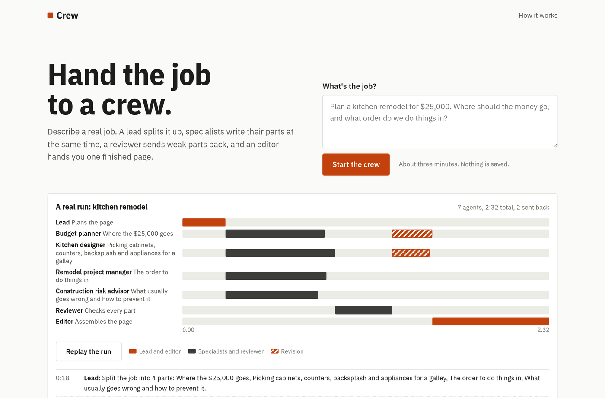
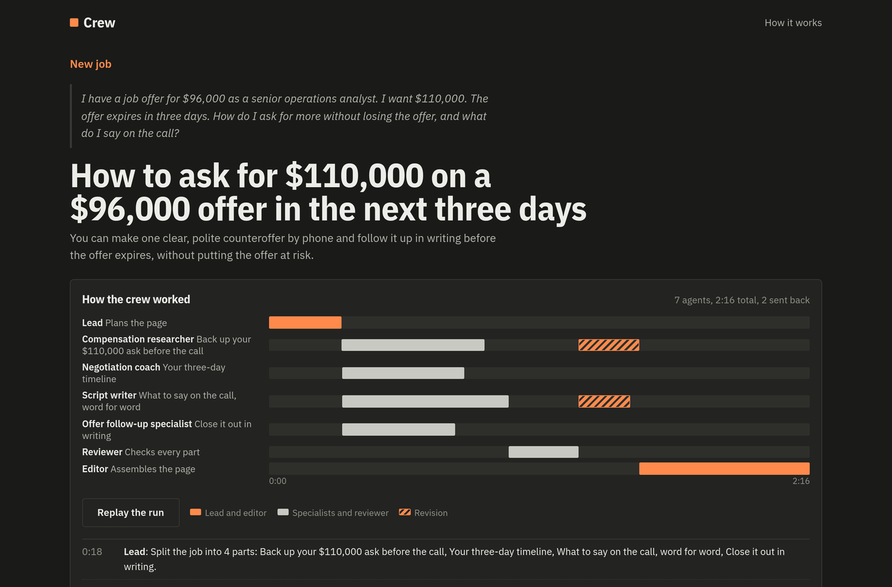

# Crew

Hand a crew of AI agents a real job. Watch them plan it, split it, check each other, and hand back one finished page.

**Live:** https://crew.meetdominic.me



## How the crew works

1. **Lead.** Reads the job, writes down its assumptions, splits the page into 3 or 4 parts, briefs a specialist for each, and sets the checks the page must pass.
2. **Specialists.** Write their parts at the same time. Each sees the whole outline so parts do not overlap, and passes on any fact the others must agree with (a total, a date).
3. **Reviewer.** Reads every part against the lead's checks, sends up to two parts back with specific notes, and lists disagreements between parts.
4. **Specialists again.** Revise the parts that were sent back.
5. **Editor.** Assembles the page, settles the disagreements, cuts repetition, adds the summary and next steps. Nothing new goes in that no part said.

In the salary sample, the reviewer caught one part telling the reader to ask for $111,000 while the script said $110,000, and a signing bonus that was $5,000 in one place and $8,000 in another. Both were fixed in revision.



## The timeline

Each lane is one agent and each bar is one piece of work, drawn to scale. Bars that line up ran in parallel. Hatched bars are revisions. Live jobs stream every step to the page (server-sent events) and the bars grow as the work happens. The samples are recorded runs of the same pipeline with their real timings, and can be replayed.

## Run it

```bash
npm install
npm run build
npx wrangler dev --var MOCK_ENGINE:1   # stand-in model, no API key needed
```

Live jobs need Worker secrets: `ANTHROPIC_API_KEY`, and `ANTHROPIC_WORKSPACE_ID` for organisation-level keys. Without a key the samples work and live jobs show as paused.

## Tests

```bash
npm test        # the orchestration (parallel start, review loop, caps), the stream, limits, and the samples
npm run e2e     # phone (390x844, 360x640) and desktop walkthrough in light and dark, against a running dev server
```

## License

MIT
